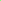
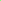
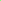

<div align="center">

# 🛒 Mane Bazar

**A Modern, High-Performance Grocery E-Commerce Platform Built for Local Indian Kiranas**

[](https://github.com/codewithharshx/Mane-Bazar/actions)
[](LICENSE)
[](https://nodejs.org/)
[](https://react.dev/)
[](https://vitejs.dev/)
[](https://expressjs.com/)
[](https://www.mongodb.com/)
[](https://tailwindcss.com/)
[](https://razorpay.com/)

[Explore Documentation](docs/) • [Architecture](docs/ARCHITECTURE.md) • [REST API](docs/API_REFERENCE.md) • [Local Setup](docs/INSTALLATION.md) • [Report Bug](https://github.com/codewithharshx/Mane-Bazar/issues)

</div>

---

## 📖 Introduction

**Mane Bazar** is a full-stack e-commerce web platform engineered to bridge local neighborhood grocery stores (*kiranas*) with digital-first consumers. 

In traditional Indian retail, local kirana merchants face intense competition from centralized quick-commerce aggregators while struggling with complex inventory systems, high commissions, and rigid catalog requirements. Mane Bazar solves this by offering a lightweight, merchant-first commerce platform that delivers:

- **Hyperlocal Kirana Discovery:** Match customers with partner neighborhood kirana stores within a configurable 25 km delivery radius based on pincode and GPS coordinates.
- **Instant In-Memory Development:** Zero-friction onboarding for developers with automatic embedded in-memory MongoDB—clone and run in seconds without setting up external database servers.
- **Server-Authoritative Cart & Pricing:** Prevents client-side monetary tampering by calculating item totals, discounts, taxes, and delivery fees strictly on the backend.
- **Atomic Stock Reservation:** Mongoose database session transactions prevent overselling during checkout spikes, complemented by an automated 15-minute pending order cleanup sweeper.
- **Frictionless Indian Checkout:** Integrated Razorpay checkout supporting UPI (Google Pay, PhonePe, Paytm), Netbanking, Debit/Credit Cards, alongside standard Cash on Delivery (COD).

---

## 📸 Application Previews

> [!NOTE]
> High-resolution interface captures can be placed in [`screenshots/`](screenshots/). See [`screenshots/README.md`](screenshots/README.md) for capture guidelines.

<div align="center">

| 🏪 Storefront & Discovery | 📦 Product Catalog & Filters |
|:---:|:---:|
| <br><sub>*Storefront banner, categories & promotional strips*</sub> | <br><sub>*Faceted category search, price sorting & badges*</sub> |

| 🛒 Shopping Cart & Discounts | 💳 Secure Checkout & Payments |
|:---:|:---:|
| <br><sub>*Slide-over drawer, quantity limits & coupon engine*</sub> | <br><sub>*Saved addresses, Razorpay UPI & Cash on Delivery*</sub> |

| 📊 Merchant Analytics Dashboard | 📱 Mobile Responsive Experience |
|:---:|:---:|
| <br><sub>*Revenue curves, order status & inventory alerts*</sub> | <br><sub>*Touch-optimized bottom navigation & quick cart*</sub> |

</div>

---

## 🚀 Verified Feature Matrix

Every feature listed below has been verified directly against the production codebase:

### 🛍️ Customer Experience
- **Responsive Kirana UI:** Built with Tailwind CSS, Framer Motion, and mobile-optimized navigation drawers.
- **Grocery Category Navigation:** 12 structured staple categories (Atta & Flours, Rice & Grains, Dals & Pulses, Cooking Oils, Spices & Masalas, Dairy, Beverages, Snacks, Packaged Food, Household Care, Personal Care, Dry Fruits).
- **Persistent Wishlist & Cart:** React Context state persisted across sessions with LocalStorage.

### 🔐 Authentication & Session Security
- **Email & Password Authentication:** Passwords hashed with salted Bcrypt (12 rounds).
- **OTP Email Verification:** Cryptographic 6-digit numeric OTP with 10-minute TTL, 60s resend cooldown, and hourly rate limits.
- **Google OAuth 2.0:** Secure Passport Google strategy with token serialization and profile matching.
- **JWT Access / Refresh Rotation:** 15-minute access token in memory paired with 7-day secure `HttpOnly` refresh cookie.
- **Double-Submit CSRF Cookie:** `XSRF-TOKEN` cookie validated against `x-csrf-token` on all state-mutating requests.

### 🔍 Product Discovery & Store Range
- **Instant Search & Faceting:** Case-insensitive search across titles, brands, and descriptions.
- **Store Distance Calculator:** Pincode and coordinate distance algorithm validating store delivery eligibility within 25 km.
- **Pre-Seeded Catalog:** Over 360 authentic Indian kirana items complete with realistic MRPs, discounted selling prices, and pack units.

### 💰 Pricing, Coupons & Checkout
- **Server-Authoritative Totals:** Strict monetary calculation preventing client-side price modification.
- **Flexible Coupon Engine:** Supports percentage and flat rupee discounts, minimum order amount thresholds, and maximum discount caps.
- **Atomic Stock Reservation:** Mongoose session transactions decrement inventory atomically when an order is created, rolling back cleanly if any line item is out of stock.
- **Background Stock Sweeper:** Periodic sweeper restores reserved stock for abandoned pending payment orders after 15 minutes.

### 💳 Payments & Billing
- **Razorpay Online Payments:** Server-side order creation and client popup supporting UPI, Cards, and Netbanking.
- **HMAC SHA-256 Verification:** `crypto.timingSafeEqual` signature verification guarding against payment tampering.
- **Webhook Reconciliation:** Raw body webhook listener processing `payment.captured`, `payment.failed`, and `refund.processed`.
- **Cash on Delivery (COD):** Seamless COD ordering with pending payment tracking.
- **PDF Invoice Generation:** Secure on-the-fly PDF invoice generation using PDFKit, streamed exclusively to authenticated order owners.

### 📦 Merchant Dashboard & Operations
- **Real-Time Analytics:** Visual revenue area charts and order distribution graphs powered by Recharts.
- **Product & Inventory Management:** Inline stock editing and product CRUD with `AdminAuditLog` tracking.
- **Order State Machine:** Merchant workflow tracking order progression: `PLACED` → `CONFIRMED` → `PACKED` → `OUT_FOR_DELIVERY` → `DELIVERED`.

---

## 🛠️ Technology Stack

| Layer | Technologies | Purpose |
|-------|--------------|---------|
| **Frontend** | React 18, Vite 6, Tailwind CSS 3 | Reactive single-page application and modern layout system |
| **State & Animations** | React Context API, Framer Motion | Lightweight global store and fluid page transitions |
| **Icons & Charts** | Lucide React, Recharts | Consistent iconography and responsive SVG analytics charts |
| **Backend** | Node.js, Express 4 | Modular REST API and request pipeline |
| **Database** | MongoDB, Mongoose 8 | Document database with schema validation and transactions |
| **Local DB Engine** | `mongodb-memory-server` | Zero-configuration local database requiring no daemon setup |
| **Authentication** | JWT, BcryptJS, Passport Google OAuth | Secure token sessions and social authentication |
| **Payments** | Razorpay Node SDK, Crypto HMAC | Online payment gateway and webhook verification |
| **Invoicing** | PDFKit | Vector PDF generation for downloadable tax receipts |
| **Asynchronous Jobs** | BullMQ, IORedis, Nodemailer | Background email queue with graceful fallback |
| **Security & Auditing** | Helmet, CORS, Express Rate Limit, Mongo Sanitize | HTTP header hardening, origin whitelisting, and rate limits |
| **Testing** | Node.js Test Runner (`node --test`) | Native, zero-dependency unit and integration test runner |

---

## 🏗️ Repository Architecture

```
Mane-Bazar/
├── .github/                 # GitHub Actions workflows & issue templates
│   ├── ISSUE_TEMPLATE/      # Standardized bug report and feature templates
│   ├── PULL_REQUEST_TEMPLATE.md
│   └── workflows/ci.yml     # CI pipeline (Lint, Test, Secret Scan)
├── .husky/                  # Git pre-commit hooks (Secret scanning)
├── client/                  # Frontend Vite React SPA
│   ├── public/              # Static icons and manifest assets
│   ├── src/                 # Components, Contexts, Hooks, Pages, Services
│   ├── .env.example         # Client environment template
│   └── package.json         # Frontend dependencies & scripts
├── server/                  # Backend Express REST API
│   ├── config/              # Database, Passport, and environment schemas
│   ├── controllers/         # Request handling & schema validation
│   ├── data/                # Pre-seeded 360+ item grocery catalog
│   ├── middleware/          # Security, CSRF, Auth, Rate limiting
│   ├── models/              # Mongoose data schemas & compound indexes
│   ├── routes/              # Express endpoint definitions
│   ├── scripts/             # Seed CLI, dataset generator, admin tools
│   ├── services/            # Atomic business logic, email, invoices
│   ├── templates/           # Responsive HTML email notification templates
│   ├── tests/               # Automated unit & integration test suites
│   ├── .env.example         # Backend environment template
│   ├── package.json         # Backend dependencies & test scripts
│   └── server.js            # Express server bootstrap & graceful shutdown
├── docs/                    # Exhaustive technical documentation
│   ├── ARCHITECTURE.md      # Detailed system & sequence diagrams
│   ├── INSTALLATION.md      # Step-by-step local setup guide
│   ├── ENVIRONMENT.md       # Complete environment variable reference
│   ├── API_REFERENCE.md     # Full REST API specification
│   ├── AUTHENTICATION.md    # Auth flow, JWT rotation & RBAC
│   ├── PAYMENT_FLOW.md      # Razorpay, UPI, COD & webhook lifecycle
│   ├── DEPLOYMENT.md        # Production cloud deployment guide
│   ├── CONTRIBUTING.md      # Branching, commits & PR rules
│   └── REPOSITORY_AUDIT.md  # Comprehensive technical health report
├── screenshots/             # Visual previews & dimension guidelines
├── .editorconfig            # Universal editor formatting
├── .gitattributes           # Line ending normalization
├── .gitignore               # Ignored dependencies, secrets & builds
├── .env.example             # Repository-level environment template
├── LICENSE                  # MIT License
├── package.json             # Root runner manifest
├── run.bat                  # One-click Windows startup script
└── run.sh                   # One-click macOS / Linux startup script
```

---

## ⚡ Quickstart & Installation

### Option 1: Automated Launch (Recommended)

#### On Windows
```cmd
git clone https://github.com/codewithharshx/Mane-Bazar.git
cd Mane-Bazar
run.bat
```

#### On macOS / Linux
```bash
git clone https://github.com/codewithharshx/Mane-Bazar.git
cd Mane-Bazar
chmod +x run.sh
./run.sh
```

---

### Option 2: Manual Setup

1. **Clone the repository:**
   ```bash
   git clone https://github.com/codewithharshx/Mane-Bazar.git
   cd Mane-Bazar
   ```

2. **Install root dependencies:**
   ```bash
   npm install
   ```

3. **Configure & start the backend:**
   ```bash
   cd server
   npm ci
   cp .env.example .env
   npm run seed        # Seeds 360+ grocery items into in-memory database
   npm run dev         # Starts backend API on http://localhost:5000
   ```

4. **Configure & start the frontend:**
   ```bash
   cd ../client
   npm ci
   cp .env.example .env.local
   npm run dev         # Starts frontend on http://localhost:5173
   ```

---

## 🩺 Health Checks & Verification

After launching the servers, verify operational health via HTTP:

```bash
# 1. API Liveness Check
curl http://localhost:5000/api/health

# 2. Database Readiness Check
curl http://localhost:5000/api/ready
```

---

## 🔒 Security Architecture

Mane Bazar enforces rigorous defense-in-depth security principles:

1. **Zero Secret Leakage:** No credentials, API tokens, or `.env` files are tracked in version control. All example files use sanitized placeholders.
2. **Pre-Commit Secret Scanning:** Husky pre-commit hooks run `@secretlint` before any commit is accepted.
3. **Double-Submit CSRF Protection:** All state-modifying requests require a cryptographic CSRF token matching the session cookie.
4. **NoSQL Injection Defense:** `express-mongo-sanitize` strips dollar-prefixed operators from query parameters and request bodies.
5. **Rate Limiting:** Granular rate limits protect authentication, OTP dispatch, and payment endpoints against brute-force attacks.
6. **Payment Tampering Guard:** Razorpay signatures are verified using timing-safe comparisons (`crypto.timingSafeEqual`).
7. **Secure Invoicing:** Invoices are generated dynamically and served through authenticated role-checked endpoints rather than public static folders.

---

## 📚 Documentation Directory

Explore the dedicated documentation guides in [`docs/`](docs/):

- 🏛️ [System Architecture](docs/ARCHITECTURE.md)
- ⚙️ [Installation & Troubleshooting](docs/INSTALLATION.md)
- 🔑 [Environment Configuration Reference](docs/ENVIRONMENT.md)
- 📡 [REST API Specification](docs/API_REFERENCE.md)
- 🛡️ [Authentication & RBAC](docs/AUTHENTICATION.md)
- 💳 [Payment Processing & Lifecycle](docs/PAYMENT_FLOW.md)
- 🚀 [Production Deployment Guide](docs/DEPLOYMENT.md)
- 🤝 [Contribution Guidelines](docs/CONTRIBUTING.md)
- 📋 [Repository Audit & Verification Report](docs/REPOSITORY_AUDIT.md)

---

## 🧪 Testing & Verification

Run the automated test suite locally:

```bash
# Run backend test suite (17 automated tests)
npm test

# Run frontend build verification
npm run build
```

---

## 🤝 Contributing

We welcome community contributions! Please review [`docs/CONTRIBUTING.md`](docs/CONTRIBUTING.md) for our Git branching model, Conventional Commits specification, and pull request requirements.

1. Fork the Project
2. Create your Feature Branch (`git checkout -b feat/AmazingFeature`)
3. Commit your Changes (`git commit -m 'feat: Add some AmazingFeature'`)
4. Push to the Branch (`git push origin feat/AmazingFeature`)
5. Open a Pull Request

---

## 📄 License & Credits

This project is licensed under the **MIT License** — see the [LICENSE](LICENSE) file for details.

Maintained by **[Harshwardha Ramdas Sathe](https://github.com/codewithharshx)** and the Mane Bazar open-source contributors.
