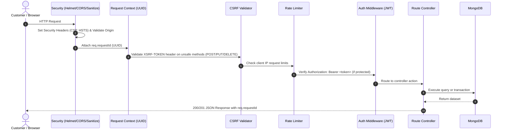

# Mane Bazar — System Architecture & Design Overview

This document describes the architectural layout, subsystem responsibilities, data flow, and runtime mechanics of the **Mane Bazar** grocery e-commerce platform.

---

## 1. System Overview

Mane Bazar is designed as a modular, full-stack **MERN** (MongoDB, Express, React, Node.js) web application engineered to emulate and empower local Indian grocery kiranas.

```
┌─────────────────────────────────────────────────────────────────────────┐
│                           Client Browser                                │
│                   (React 18 + Vite + Tailwind CSS)                      │
│                        http://localhost:5173                            │
└────────────────────────────────────┬────────────────────────────────────┘
                                     │ HTTPS / REST API
                                     ▼
┌─────────────────────────────────────────────────────────────────────────┐
│                      Express.js Gateway & Server                        │
│                        http://localhost:5000                            │
│                                                                         │
│  [Middleware Pipeline]                                                  │
│  ├── Helmet (CSP, FrameGuard)         ├── CSRF Protection (XSRF-TOKEN)  │
│  ├── CORS (Whitelist validation)      ├── Mongo Sanitize (NoSQL Inp.)   │
│  ├── Morgan + UUID Request Tracking   ├── Global & Route Rate Limiters  │
│                                                                         │
│  [API Routing Layer]                                                    │
│  ├── /api/auth       (Registration, Login, OTP, Google OAuth)          │
│  ├── /api/products   (Catalog discovery, Filtering, Search, Stock)      │
│  ├── /api/stores     (Kirana partner discovery & Delivery range)       │
│  ├── /api/categories (Product taxonomy classification)                  │
│  ├── /api/coupons    (Discount engine & Cart coupon validation)         │
│  ├── /api/orders     (Atomic order placement & PDF invoice streaming)   │
│  ├── /api/payment    (Razorpay orders, Webhooks, Signature verification)│
│  └── /api/admin      (RBAC Dashboard, Inventory, Metrics, Audit logs)   │
└────────────────────┬───────────────────────────────────┬────────────────┘
                     │ Mongoose ORM                      │ External APIs
                     ▼                                   ▼
┌──────────────────────────────────────┐  ┌───────────────────────────────┐
│            Database Layer            │  │       External Services       │
│  ├── In-Memory MongoDB (Development) │  │  ├── Razorpay (Gateway & Webh)│
│  └── MongoDB Atlas (Production)      │  │  ├── Google OAuth 2.0 (Auth)  │
│                                      │  │  ├── Twilio (WhatsApp alerts) │
│                                      │  │  └── Nodemailer/BullMQ (Email)│
└──────────────────────────────────────┘  └───────────────────────────────┘
```

---

## 2. Frontend Architecture (`client/`)

The frontend is a single-page application (SPA) built on **React 18** and bundled with **Vite**.

### 2.1 Technology Highlights
- **Vite:** High-performance ESM development server and Rollup production bundler.
- **Tailwind CSS:** Utility-first styling with responsive breakpoints and customized Indian Kirana visual tokens.
- **Framer Motion:** Declarative animations for page transitions, modals, and cart drawers.
- **Recharts:** Interactive SVG-based data visualizations for the merchant analytics dashboard.
- **Lucide React:** Consistent iconography across store navigation and product badges.

### 2.2 Directory Structure
```
client/src/
├── components/          # Reusable UI widgets
│   ├── AdminDashboardCharts.jsx  # SVG revenue and status charts
│   ├── AdminShell.jsx            # Merchant sidebar and header frame
│   ├── CartDrawer.jsx            # Slide-over quick cart drawer
│   ├── CategoryCard.jsx          # Grocery category thumbnail card
│   ├── ErrorBoundary.jsx         # Global error fallback component
│   ├── Footer.jsx                # Site footer with store contact info
│   ├── HeroSlider.jsx            # Homepage promotional carousel
│   ├── Navbar.jsx                # Search bar, category drop, cart counter
│   ├── OfferStrip.jsx            # Top promotional alert banner
│   ├── PageTransition.jsx        # Route animation wrapper
│   ├── ProductCard.jsx           # Stock-aware product display
│   ├── ProductImage.jsx          # Fallback-safe product image renderer
│   ├── ProtectedRoute.jsx        # Auth & Role-based route guard
│   ├── QuickViewModal.jsx        # Fast product detail modal
│   ├── SkeletonLoader.jsx        # Content loading placeholders
│   ├── StatusBadge.jsx           # Order state indicator pill
│   └── TrustBadges.jsx           # Local store guarantee icons
├── context/             # Global React state providers
│   ├── AuthContext.jsx           # User session, JWT tokens, login/logout
│   ├── CartContext.jsx           # Cart items, quantity limits, localStorage sync
│   └── WishlistContext.jsx       # Saved favorite products
├── hooks/               # Custom React hooks
│   └── useDebounce.js            # Debounce input for real-time search
├── layouts/             # Page structural layouts
│   └── AppShell.jsx              # Main customer layout shell
├── pages/               # Routed page components
│   ├── HomePage.jsx              # Landing storefront
│   ├── ProductsPage.jsx          # Catalog filter & search page
│   ├── ProductDetailPage.jsx     # Full product details view
│   ├── CartPage.jsx              # Cart review and coupon input
│   ├── CheckoutPage.jsx          # Shipping address & payment choice
│   ├── OrdersPage.jsx            # Customer order history
│   ├── OrderDetailPage.jsx       # Real-time order progress & invoice link
│   ├── LoginPage.jsx             # Credentials & Google OAuth sign-in
│   ├── RegisterPage.jsx          # New customer registration
│   ├── ForgotPasswordPage.jsx    # Password recovery email request
│   ├── ResetPasswordPage.jsx     # Token-based password reset form
│   ├── VerifyEmailPage.jsx       # 6-digit OTP email verification
│   ├── WishlistPage.jsx          # Customer saved items
│   ├── StoreListPage.jsx         # Partner kirana store directory
│   ├── StoreDetailPage.jsx       # Individual store profile
│   └── Admin*.jsx                # Merchant dashboard, orders, inventory, users
└── services/            # Axios API transport layer
    ├── apiClient.js              # Base Axios instance with CSRF & JWT interceptors
    ├── authApi.js                # Auth endpoints
    ├── productApi.js             # Product catalog endpoints
    ├── orderApi.js               # Order placement & history endpoints
    ├── paymentApi.js             # Razorpay order creation & verification
    └── adminApi.js               # Merchant administration endpoints
```

---

## 3. Backend Architecture (`server/`)

The backend is an **Express** REST API adhering to layered separation of concerns.

### 3.1 Layer Responsibilities

```
Incoming Request
      │
      ▼
[Middleware Layer]     ── Rate limiting, CSRF validation, Authentication & JWT verification
      │
      ▼
[Routing Layer]        ── Maps HTTP method + path to controller actions
      │
      ▼
[Controller Layer]     ── Validates request schemas, sanitizes inputs, handles HTTP responses
      │
      ▼
[Service Layer]        ── Encapsulates atomic business logic (orders, invoices, emails, audit)
      │
      ▼
[Data Layer / Models]  ── Mongoose schemas, compound indexes, database transactions
```

### 3.2 Directory Structure
```
server/
├── config/              # Runtime environment, DB connection, Passport
│   ├── db.js                 # MongoDB connection & in-memory runner
│   ├── env.js                # Environment variable schema validation
│   └── passport.js           # Google OAuth 2.0 strategy configuration
├── controllers/         # HTTP request handlers
│   ├── adminController.js    # Merchant operations & sales analytics
│   ├── authController.js     # Auth, session, password reset, OTP
│   ├── categoryController.js # Taxonomy handlers
│   ├── couponController.js   # Coupon code validation
│   ├── orderController.js    # Order lifecycle & invoice retrieval
│   ├── paymentController.js  # Razorpay integration
│   ├── productController.js  # Catalog queries & search
│   ├── storeController.js    # Kirana store lookup & delivery range
│   └── webhookController.js  # Razorpay raw webhook processor
├── data/                # Static seed datasets
│   └── catalog.seed.json     # 360+ authentic kirana grocery products
├── middleware/          # Express request interceptors
│   ├── asyncHandler.js       # Exception propagation wrapper
│   ├── authMiddleware.js     # JWT bearer & admin role verification
│   ├── csrfProtection.js     # Double-submit CSRF cookie validator
│   ├── errorMiddleware.js    # Centralized 404 and 500 error handler
│   ├── rateLimiter.js        # Window-based rate limiting
│   ├── requestContext.js     # UUID request ID tagger
│   ├── validateRequest.js    # Express-validator error checker
│   └── validators.js         # Input validation schemas
├── models/              # Mongoose data models
│   ├── AdminAuditLog.js      # Audit trail for merchant modifications
│   ├── Category.js           # Taxonomy definition
│   ├── Coupon.js             # Discount codes and rules
│   ├── IdempotencyKey.js     # Duplicate request protection cache
│   ├── Order.js              # Order records & status history
│   ├── OTPModel.js           # Ephemeral email verification OTPs
│   ├── Payment.js            # Transaction ledger records
│   ├── Product.js            # Grocery items and stock counts
│   ├── Store.js              # Partner kirana stores and GPS coordinates
│   └── User.js               # Customers and merchants
├── routes/              # Express route declarations
├── scripts/             # Maintenance and CLI utilities
│   ├── admin-cli.js          # CLI for managing admin roles
│   ├── generate-dataset.js   # Catalog generator script
│   └── seed.js               # Database seeding CLI
├── services/            # Core business workflows
│   ├── adminAuditService.js  # Audit log recorder
│   ├── emailService.js       # BullMQ / Nodemailer asynchronous dispatcher
│   ├── idempotencyService.js # Idempotency validation engine
│   ├── invoiceService.js     # PDFKit order invoice renderer
│   ├── orderService.js       # Atomic transactions & pending sweeps
│   ├── otpPolicy.js          # Cooldown and retry counter enforcement
│   ├── paymentService.js     # Payment entity records
│   └── whatsappService.js    # Twilio WhatsApp messaging client
├── templates/email/     # HTML email notification templates
├── tests/               # Native Node.js automated test suites
├── utils/               # Helper routines (tokens, regex, seedData)
└── server.js            # Express application bootstrap & graceful shutdown
```

---

## 4. Request Lifecycle & Middleware Pipeline

Every HTTP request traverses a hardened middleware pipeline before reaching controller code:



---

## 5. Database Architecture & Concurrency Control

### 5.1 Dual-Mode Operation
1. **In-Memory Mode (Default in Development):**
   - Automatically bootstraps `mongodb-memory-server`.
   - Requires zero local database installations or Atlas credentials.
   - Ideal for continuous integration and immediate local setup.
2. **Production Mode (MongoDB Atlas):**
   - Enabled by setting `MONGODB_MEMORY_SERVER=false` and supplying `MONGO_URI`.
   - Uses Mongoose connection pooling with automated reconnection and graceful shutdown hooks.

### 5.2 Atomic Stock Reservation & Concurrency Safety
To prevent overselling and race conditions when multiple customers purchase limited inventory simultaneously:
- **Mongoose Session Transactions:** Checkout calls `createPendingPaymentOrder()` inside an atomic transaction.
- **Atomic Stock Checks:** The stock count for every line item is verified and decremented atomically. If any item is out of stock, the transaction aborts and rolls back completely.
- **Automatic Sweeper:** An automated background process (`cleanupExpiredPendingOrders`) scans every 60 seconds for orders that have remained in `PENDING_PAYMENT` for over 15 minutes. It automatically restores the reserved inventory and marks the orders as `EXPIRED`.

---

## 6. Resilience & Graceful Shutdown

The application server actively traps `SIGTERM` and `SIGINT` signals:
1. Stops accepting incoming HTTP traffic.
2. Stops the background pending-payment sweep interval.
3. Flushes and shuts down the BullMQ email queue worker.
4. Closes active MongoDB connections cleanly before exiting with code 0.

