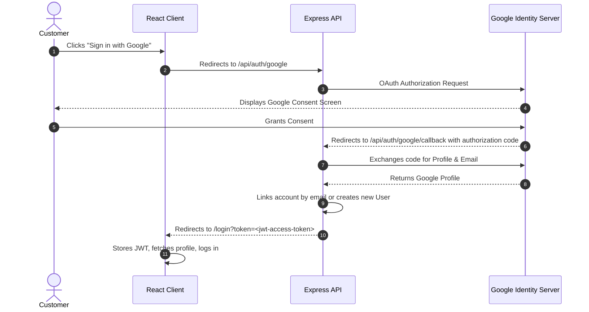

# Mane Bazar — Authentication & Authorization Architecture

This document details the authentication protocols, token management strategies, Google OAuth 2.0 implementation, and Role-Based Access Control (RBAC) enforced within **Mane Bazar**.

---

## 1. Authentication Architecture Overview

Mane Bazar implements a modern, secure hybrid authentication model:
- **Short-Lived Access Tokens (JWT):** Passed via the `Authorization: Bearer <token>` header to authenticate API requests. Valid for 15 minutes.
- **Long-Lived Refresh Tokens:** Stored in a secure, `HttpOnly`, `SameSite` browser cookie. Valid for 7 days.
- **CSRF Token Protection:** Double-submit cookie pattern (`XSRF-TOKEN` cookie validated against the `x-csrf-token` header) prevents cross-site request forgery on state-changing requests.

```
┌────────────────────────────────────────────────────────────────────────┐
│                        Customer Browser                                │
└─────────────┬────────────────────────────────────────────┬─────────────┘
              │ 1. POST /api/auth/login                    │ 3. API Request with Bearer Token
              ▼                                            ▼
┌───────────────────────────────┐            ┌───────────────────────────┐
│     Express Auth Endpoint     │            │    Protected Endpoints    │
│  ├── Validate credentials     │            │  ├── Extract Bearer token │
│  ├── Issue Access JWT (15m)   │            │  ├── Verify signature     │
│  └── Set Refresh Cookie (7d)  │            │  └── Check role & expiry  │
└───────────────────────────────┘            └───────────────────────────┘
```

---

## 2. Customer Registration & Verification Flow

### 2.1 Password Hashing
- User passwords are automatically salted and hashed using **Bcrypt** with 12 salt rounds before persisting to PostgreSQL.
- Raw passwords are never stored in plaintext or logged.

### 2.2 6-Digit Email Verification (OTP)
When a customer registers:
1. An ephemeral 6-digit cryptographic OTP is generated via `crypto.randomInt()`.
2. The OTP record is saved in PostgreSQL with an automated 10-minute expiration timestamp.
3. An email containing the OTP is queued via Nodemailer.
4. **Policy Enforcement (`apps/backend/src/infrastructure/services/otpPolicy.ts`):**
   - **Cooldown:** Customers must wait 60 seconds before requesting a new OTP.
   - **Max Attempts:** The OTP is invalidated if entered incorrectly 5 times.
   - **Hourly Limit:** A maximum of 5 OTP dispatches per email address per hour is strictly enforced.

---

## 3. Login & Session Lifecycle

### 3.1 Credential Login
1. Customer submits `email` and `password` to `POST /api/auth/login`.
2. Rate limiting (`authRateLimiter`) restricts submissions to 20 attempts per 15-minute window per IP.
3. The server compares the password using `bcrypt.compare()`.
4. Upon match, the server generates:
   - An **Access Token** signed with `JWT_SECRET` containing `{ id, email, role }`.
   - A **Refresh Token** signed with `JWT_REFRESH_SECRET`.
5. The refresh token is set as an `HttpOnly` cookie:
   ```javascript
   res.cookie("refreshToken", refreshToken, {
     httpOnly: true,
     secure: process.env.COOKIE_SECURE === "true",
     sameSite: process.env.COOKIE_SAME_SITE || "lax",
     maxAge: 7 * 24 * 60 * 60 * 1000 // 7 days
   });
   ```

### 3.2 Token Refresh Protocol
When the frontend Axios interceptor (`apps/frontend/src/services/apiClient.ts`) detects a `401 Unauthorized` response with an expired access token:
1. It pauses pending requests and automatically calls `POST /api/auth/refresh-token`.
2. The browser automatically sends the `refreshToken` cookie.
3. The server verifies the token signature and verifies the user exists in the database.
4. The server returns a brand-new access token.
5. The failed request is retried seamlessly without disrupting the customer's checkout or browsing experience.

### 3.3 User Profile Sanitization (`/api/auth/me`)
When user profile data is queried, sensitive fields are stripped:
- Hashed passwords (`password`)
- Verification tokens & OTP hashes (`verificationToken`, `passwordResetTokenHash`)

---

## 4. Google OAuth 2.0 Integration

Mane Bazar supports Google Sign-In via `passport-google-oauth20` on the backend and `@react-oauth/google` on the client:



---

## 5. Role-Based Access Control (RBAC)

Mane Bazar defines two primary authorization roles:

| Role | Permissions |
|------|-------------|
| `customer` | Browse catalog, search products, manage personal cart & wishlist, place orders, download personal order invoices, update profile. |
| `admin` | All customer capabilities plus: access merchant analytics dashboard, add/edit/delete products, modify inventory levels, update order fulfillment stages, view merchant audit logs, manage user roles. |

### 5.1 Route Protection Enforcement
- **Backend Middleware (`apps/backend/src/presentation/middleware/authMiddleware.ts`):**
  - `protect`: Verifies JWT signature and binds `req.user`.
  - `adminOnly`: Validates that `req.user.role === 'ADMIN'`. Unauthorized requests receive `403 Forbidden`.
- **Frontend Guards (`apps/frontend/src/components/ProtectedRoute.tsx`):**
  - `<ProtectedRoute>` checks auth state and role before rendering protected pages. Unauthenticated customers are redirected to `/login` with an automatic `returnUrl`.

