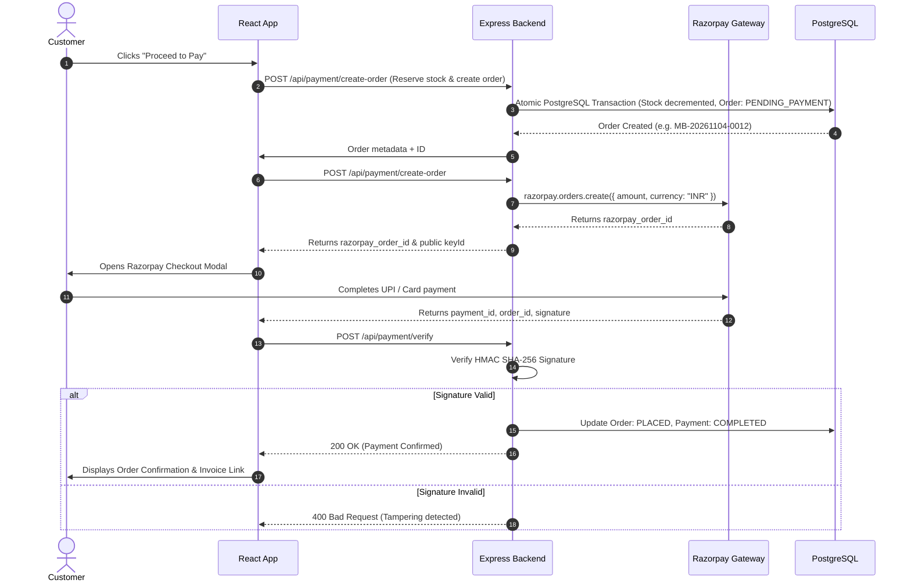

# Mane Bazar — Payment Processing & Financial Architecture

This document describes the payment workflows, stock reservation safeguards, Razorpay integration, and failure handling mechanisms in **Mane Bazar**.

---

## 1. Supported Payment Methods

Mane Bazar accommodates typical Indian grocery retail purchasing habits by offering two distinct checkout channels:

1. **Online Digital Payments (Razorpay Gateway):**
   - **UPI:** Instant payment via Google Pay, PhonePe, Paytm, BHIM, or any UPI ID.
   - **Cards:** Debit and Credit Cards (Visa, MasterCard, RuPay, Maestro).
   - **Netbanking:** 50+ Indian commercial banks.
   - **Wallets:** Paytm, Mobikwik, Airtel Money.
2. **Cash on Delivery (COD):**
   - Immediate order confirmation with zero upfront payment. Cash is collected at the customer's doorstep upon physical grocery delivery.

---

## 2. End-to-End Online Payment Flow



---

## 3. Cryptographic Signature Verification

To prevent payment tampering, client-side amount manipulation, or replay attacks, payment confirmation is never trusted directly from the frontend.

### 3.1 Verification Algorithm
The server verifies the signature using Node.js's built-in `crypto` module:

```javascript
const crypto = require("crypto");

const generatedSignature = crypto
  .createHmac("sha256", process.env.RAZORPAY_KEY_SECRET)
  .update(`${razorpay_order_id}|${razorpay_payment_id}`)
  .digest("hex");

const isSignatureValid = crypto.timingSafeEqual(
  Buffer.from(generatedSignature),
  Buffer.from(razorpay_signature)
);
```

> [!IMPORTANT]
> The comparison uses `crypto.timingSafeEqual()` to protect against timing attacks.

---

## 4. Webhook Processing (`POST /api/payment/webhook`)

In scenarios where the customer's browser crashes, network connectivity drops, or the user closes the tab immediately after authorizing a payment, Razorpay webhooks guarantee that the order status is reliably reconciled.

1. **Raw Body Parsing:**  
   The webhook route is registered with `express.raw({ type: "application/json" })` prior to standard body parsers to ensure exact byte-for-byte HMAC verification against `x-razorpay-signature`.
2. **Handled Events:**
   - `payment.captured`: Reconciles pending payments to `COMPLETED` and marks order as `PLACED`.
   - `payment.failed`: Records the failure reason in the `Payment` ledger and logs payment failure history.
   - `refund.processed`: Updates transaction status to `REFUNDED` and restores inventory if the order was cancelled.

---

## 5. Stock Reservation & Abandoned Cart Cleanup

To prevent overselling grocery inventory during peak shopping periods:

### 5.1 Atomic Stock Decrement
When an order is created (`createPendingPaymentOrder`), Prisma executes an atomic PostgreSQL transaction (`prisma.$transaction`):
- The required quantities are verified against available stock for each line item.
- Stock is atomically decremented.
- The order status is marked as `PENDING_PAYMENT`.
- If any product lacks adequate stock, the entire transaction is rolled back, returning an informative out-of-stock message to the customer.

### 5.2 15-Minute Background Sweeper
If a customer initiates an online payment but abandons the gateway checkout window:
- A background worker runs every 60 seconds via `cleanupExpiredPendingOrders()`.
- Any order remaining in `PENDING_PAYMENT` for more than 15 minutes is automatically marked as `EXPIRED`.
- The reserved product quantities are restored back to the active catalog stock.

---

## 6. Cash on Delivery (COD) Flow

For customers selecting Cash on Delivery:
1. The frontend submits `paymentMethod: "COD"`.
2. The server verifies stock atomically and records the order with `orderStatus: "PLACED"`.
3. The payment record is created with `paymentStatus: "PENDING"` and `paymentMethod: "COD"`.
4. Delivery agents collect cash upon delivery and the merchant marks the order as `DELIVERED`, which automatically updates the payment ledger to `COMPLETED`.

